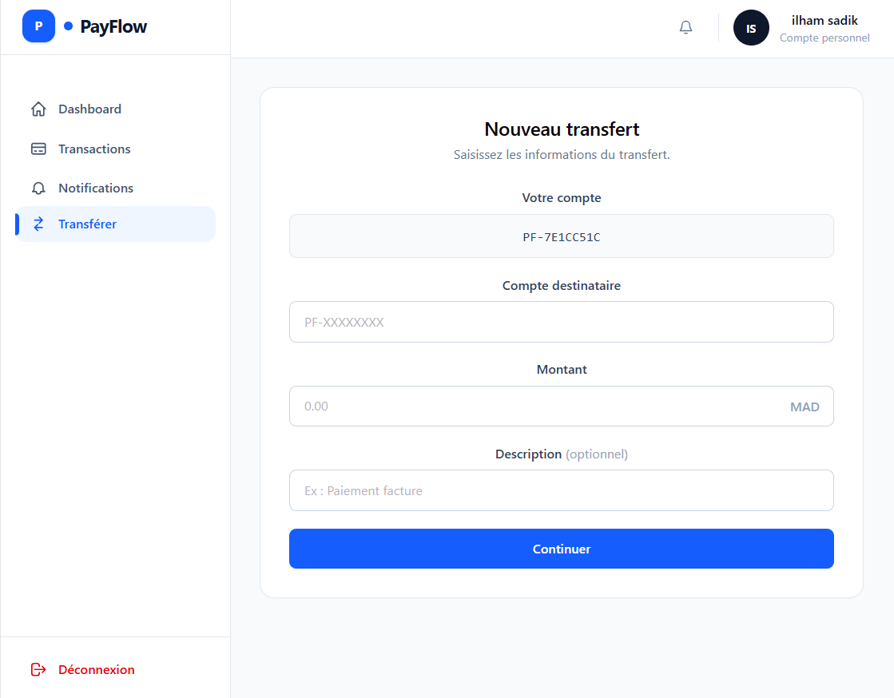
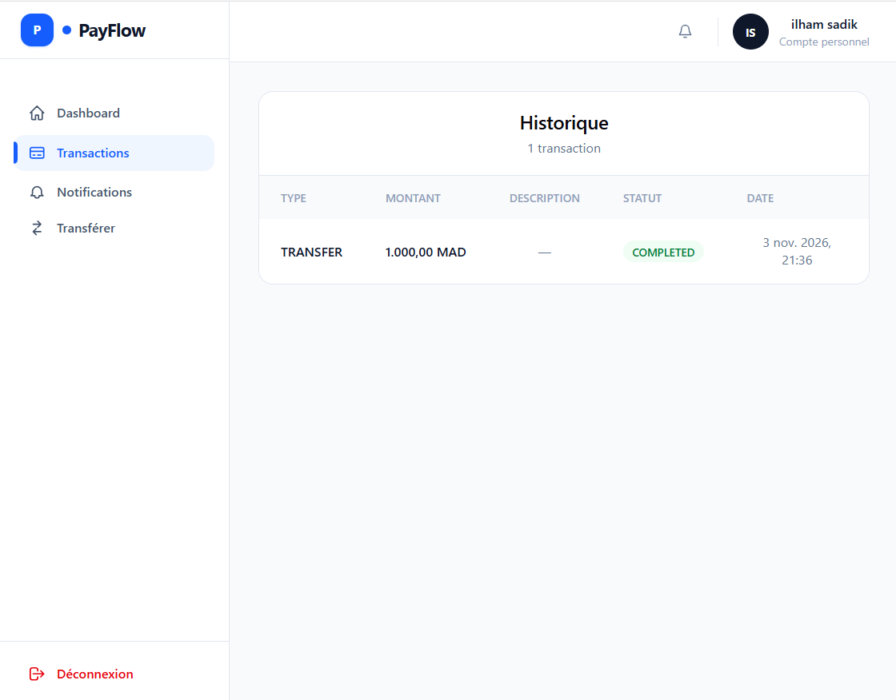
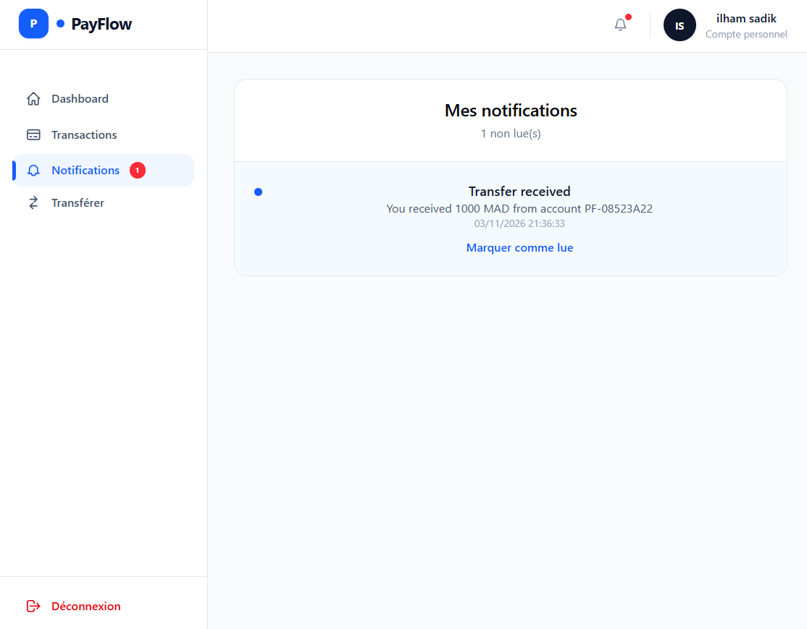
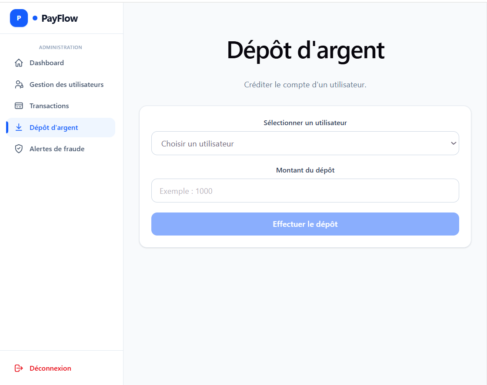

# 💳 PayFlow — Application de gestion financière

**PayFlow** est une application web Full Stack de gestion financière développée avec Spring Boot, React.js et PostgreSQL. Elle permet aux utilisateurs de gérer leurs comptes et leurs opérations financières à travers une interface sécurisée, avec un espace dédié à l'administration et à la supervision des activités.

---

## 📌 Présentation du projet

PayFlow a pour objectif de proposer une plateforme centralisée permettant de :

- Gérer les comptes utilisateurs.
- Effectuer et suivre des opérations financières.
- Consulter l'historique des transactions.
- Sécuriser l'accès aux fonctionnalités selon les rôles.
- Superviser les activités à travers un espace administrateur.
- Détecter et suivre les alertes de fraude.

## 🚀 Fonctionnalités

### 👤 Espace utilisateur

- Inscription et authentification.
- Connexion sécurisée avec JWT.
- Consultation du tableau de bord.
- Création et consultation du compte bancaire.
- Consultation du solde du compte.
- Réalisation de transferts entre comptes.
- Consultation de l'historique des transactions.
- Consultation des notifications.

### 🛡️ Espace administrateur

- Authentification avec rôle ADMIN.
- Consultation des statistiques globales.
- Gestion et consultation des utilisateurs.
- Consultation des comptes utilisateurs.
- Dépôt d'argent sur un compte utilisateur.
- Enregistrement des opérations de dépôt.
- Génération de notifications après un dépôt.
- Traçabilité des opérations à travers les journaux d'audit.
- Consultation et suivi des transactions.
- Consultation des alertes de fraude.

## 🏗️ Architecture du projet

Le projet est organisé en deux parties indépendantes :

```text
PayFlow/
│
├── payflow-backend/
│   ├── src/
│   │   ├── main/
│   │   │   ├── java/
│   │   │   └── resources/
│   │   └── test/
│   ├── pom.xml
│   └── mvnw
│
├── payflow-frontend/
│   ├── public/
│   ├── src/
│   │   ├── components/
│   │   ├── pages/
│   │   ├── services/
│   │   └── ...
│   ├── package.json
│   └── vite.config.js
│
```

## 🛠️ Technologies utilisées

### Backend
- Java 17
- Spring Boot
- Spring Security
- Spring Data JPA
- JWT (JSON Web Token)
- Maven

### Frontend
- React.js
- JavaScript
- React Router
- Axios
- Tailwind CSS
- Three.js

### Base de données
- PostgreSQL

### Outils de développement
- Visual Studio Code
- Git et GitHub
- Postman

## 🔐 Sécurité

La sécurité de l'application repose sur :

- Spring Security pour la protection des endpoints REST.
- JWT pour l'authentification.
- Une gestion des rôles USER et ADMIN.
- Un contrôle d'accès basé sur les rôles.
- La vérification des autorisations d'accès aux ressources.
- La sécurisation des opérations financières côté backend.

## 📊 Base de données

PayFlow utilise PostgreSQL pour stocker les données de l'application.

Principales tables :

| Table | Description |
|---|---|
| `users` | Informations des utilisateurs |
| `roles` | Rôles de l'application |
| `user_roles` | Association utilisateurs et rôles |
| `accounts` | Comptes et soldes |
| `transactions` | Historique des opérations |
| `notifications` | Notifications utilisateurs |
| `fraud_alerts` | Alertes de fraude |
| `audit_logs` | Traçabilité des opérations |

## ⚙️ Installation et configuration

### Prérequis

Avant de lancer le projet, installer :

- Java 17
- Maven
- Node.js et npm
- PostgreSQL
- Git

### 1. Cloner le dépôt

```bash
git clone <URL_DU_DEPOT>
cd PayFlow
```

### 2. Configurer PostgreSQL

Créer la base de données :

```sql
CREATE DATABASE payflow;
```

Configurer ensuite les paramètres de connexion dans le fichier `application.properties` du backend.

**Important :** renseigner les identifiants localement et ne jamais publier les mots de passe ou les clés secrètes sur GitHub.

### 3. Lancer le backend

Ouvrir un terminal :

```bash
cd payflow-backend
```

Sous Windows :

```bash
.\mvnw.cmd spring-boot:run
```

Ou avec Maven installé :

```bash
mvn spring-boot:run
```

Le backend est accessible à :

```text
http://localhost:8081
```

### 4. Lancer le frontend

Ouvrir un deuxième terminal :

```bash
cd payflow-frontend
```

Installer les dépendances :

```bash
npm install
```

Démarrer l'application :

```bash
npm run dev
```

Le frontend est accessible à l'adresse indiquée par Vite dans le terminal (par exemple `http://localhost:5174`).

## 📸 Application Screenshots

PayFlow provides dedicated interfaces for customers and administrators.

### 👤 User Interface

#### 1. Login


#### 2. Account Creation


#### 3. User Dashboard


#### 4. Money Transfer


#### 5. Transaction History


#### 6. Notifications



### 🛡️ Administrator Interface

#### 1. Admin Dashboard


#### 2. User Management

#### 3. User Deposit


#### 4. Deposit Management


#### 5. Fraud Alerts

## 🧪 Tests

Les endpoints backend peuvent être testés avec Postman.

Les fonctionnalités principales peuvent être vérifiées à travers les interfaces utilisateur et administrateur.

## 👩‍💻 Auteur

Projet personnel Full Stack réalisé dans le but de mettre en pratique le développement d'une application web de gestion financière.

---

**PayFlow — Secure and Simple Financial Management.**
